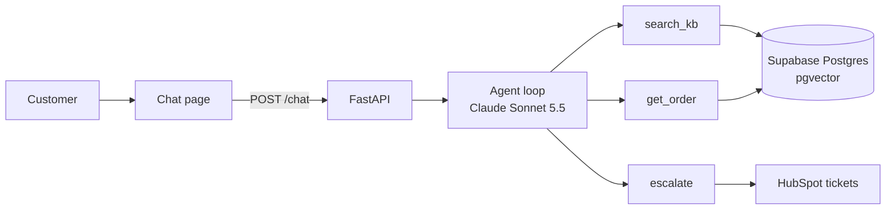

# Support agent with RAG, tools and an evaluation report

A support agent for a fictional coffee gear store. It answers from the help center, looks up orders and opens a HubSpot ticket when a person is needed, and I measured how well it does.

## The problem

Small online stores answer the same questions all day, like what shipping costs or where an order is. Before a store owner hands those to a chatbot, they need to know how often it's right and how often it makes things up.

## How it works



- The chat page sends each message to FastAPI, which issues the session id and keeps the last 10 messages of each session in memory. Each IP can send 20 messages a minute.
- The agent is a tool loop I wrote by hand, with no agent framework, and it stops after 5 tool calls in one reply.
- `search_kb` embeds the question locally with fastembed (`bge-small-en-v1.5`) and runs a cosine search over the 40 help center articles in Postgres with pgvector.
- `get_order` returns an order only when the order number and the checkout email belong to the same order. Otherwise it says "not found", without saying which one was wrong.
- `escalate` opens one HubSpot ticket per conversation with a summary, and links it to the customer's contact if one exists.
- Each reply names the article it used, and the page lists the sources under the answer.

## Evaluation

I wrote 60 test conversations the way customers write, with typos, indirect questions and two questions in one. 35 can be answered from the help center, 10 are order lookups (2 with an email that doesn't match the order), 10 should go to a person and 5 are off topic. Claude Sonnet 5.5 grades each reply against a short expected answer and the exact text the tools returned, and lists every claim that text doesn't support.

| Metric | v1 | v2 | v3 |
| --- | --- | --- | --- |
| Retrieval hit@5 (35 help center questions) | 100% | 100% | 100% |
| Retrieval MAP@5 | 0.90 | 0.95 | 0.95 |
| Correct answers (60 cases) | 85% | 100% | 100% |
| Correct with no unsupported claim | 80% | 90% | 90% |
| Invention rate (answers with an unsupported claim) | 7% | 10% | 10% |
| Escalation precision | 100% | 100% | 100% |
| Escalation recall | 100% | 100% | 100% |
| Order leaks (2 wrong-email cases) | 0 | 0 | 0 |
| Cost per answer | $0.0092 | $0.0116 | $0.0127 |
| Median latency | 4.4 s | 4.2 s | 5.1 s |

Hit@5 means the right article was in the top 5 search results, and MAP@5 also rewards ranking it higher; I used the definition from my [Map-K](https://github.com/ewerside/Map-K) repo. Escalation precision is the share of handoffs that should have happened, and recall is the share of needed handoffs that did.

A reply counts as correct when it gives the expected answer. A correct reply can still add a small detail the sources don't back, like "the repair price depends on the fault", so I also report correct replies with no unsupported claim. The full side-by-side is in [docs/evaluation-report.md](docs/evaluation-report.md), and each version has its own report and CSV in [eval/results](eval/results).

## What I changed from v1 to v2 (and v3)

v2 changed the chunk size. In v1, 6 of the 9 partial answers had found the right article but not the section with the missing detail, such as the 48-hour cutoff for pausing a subscription, so I made each article one chunk. Those 6 became correct, and so did the other 3 with no related change, so part of the jump from 85% to 100% is the judge or the model varying between runs.

v2 cost more and invented a little more: cost per answer went up 26% because each search returns whole articles, and the invention rate went from 7% to 10% (4 answers to 6).

v3 changed the system prompt. In v2, 2 replies claimed actions no tool can take, like "I marked it as urgent" (esc-08 and esc-10 in the v2 results), and one line telling the agent to describe only what its tools did took that to 0. Nothing else improved: the invention rate stayed at 10%, cost per answer went up 9% and median latency went from 4.2 s to 5.1 s.

## Limits

The store, the 300 orders and the 60 questions are synthetic, and I wrote the questions, so they cover what I thought to test. Real customer messages will be messier.

I ran each version once, so a difference of a few answers, like 7% against 10%, may be noise. 100% correct is a score on these 60 cases, and real traffic will find mistakes this set misses.

The judge is the same model as the agent, so it may miss the same kind of mistakes. I checked 10 random v1 cases by hand and agreed with the judge on all 10, but 9 of them were easy correct answers, and I didn't check v2 or v3 by hand. The judge only sees what the tools returned, so in v3 it counted one reply that listed the topics it can help with as unsupported.

Latency includes a new database connection for every search, which a connection pool would cut.

## Run it yourself

You need Python 3.11, an Anthropic API key, a Supabase project and a HubSpot test account.

1. Install:

   ```bash
   python -m venv .venv
   source .venv/bin/activate   # Windows: .venv\Scripts\activate
   pip install -r requirements.txt
   ```

2. Copy `.env.example` to `.env` and fill it in:
   - `ANTHROPIC_API_KEY`, plus `AGENT_MODEL` and `JUDGE_MODEL` (I used `claude-sonnet-5-5`).
   - `PRICE_IN_PER_MTOK=2` and `PRICE_OUT_PER_MTOK=10`, the Sonnet 5.5 prices used for cost per answer.
   - `DATABASE_URL`: the Supabase Session pooler connection string.
   - `HUBSPOT_TOKEN`: a service key with `crm.objects.contacts.read`, `crm.objects.contacts.write`, `crm.objects.tickets.read` and `crm.objects.tickets.write`, and `HUBSPOT_PORTAL_ID`.
3. Check the accounts, then build the data:

   ```bash
   python -m scripts.check_env
   python -m scripts.create_tables
   python -m scripts.make_orders
   python -m scripts.setup_hubspot
   python -m scripts.check_kb
   python -m scripts.ingest
   python -m scripts.check_search
   ```

4. Start the chat at http://127.0.0.1:8000:

   ```bash
   uvicorn app.main:app
   ```

5. Run the evaluation after a change. A full run costs about $1 with Sonnet 5.5 as agent and judge.

   ```bash
   python -m eval.run_eval run v4 --note "what you changed"
   python -m eval.run_eval compare v1 v2 v3 v4
   ```

## Notes

- I first called the store Kestrel Coffee Gear, but Kestrel Coffee Roasters is a real roaster in Vermont that also sells coffee subscriptions. I renamed the store to Wrenfield Coffee Gear, and order numbers use `WCG-10001` instead of `KCG-10001`.
- The tables live in a `support_agent` schema, not `public`. My Supabase database is shared with other portfolio projects, and Supabase exposes `public` through its REST API.
- In fastembed 0.9.1, `query_embed` for `bge-small-en-v1.5` gives the same vector as `passage_embed`. The model card recommends the instruction "Represent this sentence for searching relevant passages: " for short queries, so I add it to queries myself. On the 40 article titles used as queries, it moved the right article to first place in 40 of 40 cases instead of 39.
- HubSpot moved private apps to "Legacy apps", so I used a Service Key instead. Service keys have no `tickets` scope, so the key uses `crm.objects.tickets.read` and `crm.objects.tickets.write`.
- I first wrote the judge with a forced `grade` tool. Claude Sonnet 5.5 rejects forced tool use with a 400, so the judge returns the same three fields through structured output (`output_config.format` with a JSON schema).
- The evaluation doesn't open real HubSpot tickets. It swaps `escalate` for a stub, because what it measures is the decision to escalate and the reason. Ticket creation is tested on its own in the chat.
- HubSpot now documents date-versioned paths like `/crm/objects/2026-09/tickets`. I kept the `/crm/v3/...` paths because they still work, and switching is a one-line change per call.
- I created a separate key (`portfolio-support-agent`) instead of adding tickets scopes to the key from my lead routing project, so the two projects don't share a credential.
- I allowed myself two rounds of changes after v1, one change each, so the report has v1, v2 and v3.
- My first scoring of retrieval used the top 5 chunks. With one chunk per section, several of those came from the same article, so v1 was scored on 1 to 5 articles and looked like 97% and 0.88. I now score the first 5 distinct articles for every version, which gives v1 100% and 0.90.
- After v3 I fixed the first sentence of the article on returning an opened machine or grinder, which said yes without the "only if no beans went through it" condition. I also hardened the chat API: the server issues session ids, each IP gets 20 messages a minute, a conversation opens at most one ticket, and tool errors stay in the server log. The numbers above are from before these fixes.
