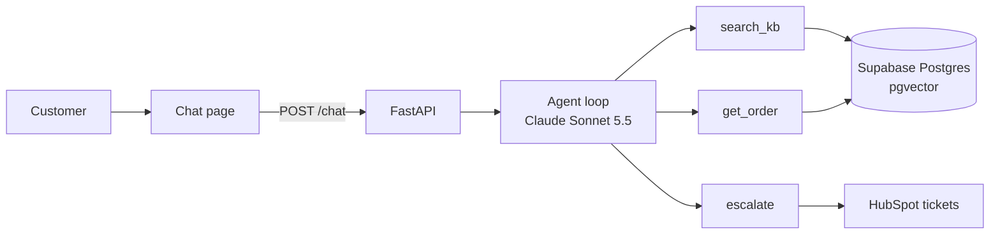

# Support agent with RAG, tools and an evaluation report

A support agent for a fictional coffee gear store that answers from the help center, looks up orders and opens a HubSpot ticket when a person is needed, with a report that measures how well it does.

## The problem

Small online stores answer the same questions all day: what shipping costs, how long returns take, where an order is. A chatbot can take those, but the store owner needs to know how often it is right, how often it makes things up and whether it hands upset customers to a person.

## How it works



- The chat page sends each message to FastAPI, which keeps the last 10 messages of each session in memory.
- The agent is a tool loop I wrote by hand, with no agent framework, and it stops after 5 tool calls in one reply.
- `search_kb` embeds the question locally with fastembed (`bge-small-en-v1.5`) and runs a cosine search over the 40 help center articles in Postgres with pgvector.
- `get_order` returns an order only when the order number and the checkout email belong to the same order. Otherwise it says "not found", without saying which one was wrong.
- `escalate` opens a HubSpot ticket with a summary of the conversation and links it to the customer's contact if one exists.
- Each reply names the article it used, and the page lists the sources under the answer.

## Evaluation

I wrote 60 test conversations the way customers write, with typos, indirect questions and two questions in one. 35 can be answered from the help center, 10 are order lookups (2 with an email that doesn't match the order), 10 should go to a person and 5 are off topic. Claude Sonnet 5.5 grades each reply against a short expected answer and the exact text the tools returned, and lists every claim that text doesn't support.

| Metric | v1 | v2 | v3 |
| --- | --- | --- | --- |
| Retrieval hit@5 (35 help center questions) | 97% | 100% | 100% |
| Retrieval MAP@5 | 0.88 | 0.95 | 0.95 |
| Correct answers (60 cases) | 85% | 100% | 100% |
| Invention rate (answers with an unsupported claim) | 7% | 10% | 10% |
| Escalation precision | 100% | 100% | 100% |
| Escalation recall | 100% | 100% | 100% |
| Order leaks (2 wrong-email cases) | 0 | 0 | 0 |
| Cost per answer | $0.0092 | $0.0116 | $0.0127 |
| Median latency | 4.4 s | 4.2 s | 5.1 s |

MAP@5 uses the average precision definition from my [Map-K](https://github.com/ewerside/Map-K) repo. I graded 10 random v1 cases myself, and the judge agreed with me on all 10. The full side-by-side is in [docs/evaluation-report.md](docs/evaluation-report.md), and each version has its own report and CSV in [eval/results](eval/results).

## What I changed from v1 to v2 (and v3)

v2 changed the chunk size. In v1, 6 of the 9 partial answers had found the right article but not the section with the missing detail, such as the 48-hour cutoff for pausing a subscription, so I made each article one chunk. Correct answers went from 85% to 100%, and cost per answer went up 26% because each search now returns whole articles.

v3 changed the system prompt. v2 still had replies like "I marked it as urgent", an action no tool can take, and one line telling the agent to describe only what its tools did took those replies from 2 to 0. The invention rate stayed at 10% and cost went up another 9%, so v3 is better on the mistake that matters most in support and worse on cost.

## Limits

The store, the 300 orders and the 60 questions are synthetic, and I wrote the questions, so they cover what I thought to test. Real customer messages will be messier.

60 cases is a small set. The invention rate moves by about 2 answers between runs, so 7% against 10% is not a real difference, and 100% correct means no errors on this set, not no errors in production.

The judge is a model too. It matched my grades on 10 of 10 sampled cases, but 10 is not enough to rule out bias. Latency includes a new database connection for every search, which a connection pool would cut.

## Run it yourself

You need Python 3.11, an Anthropic API key, a Supabase project and a HubSpot test account.

1. Install:

   ```bash
   python -m venv .venv
   source .venv/bin/activate   # Windows: .venv\Scripts\activate
   pip install -r requirements.txt
   ```

2. Copy `.env.example` to `.env` and fill it in:
   - `ANTHROPIC_API_KEY`, plus `AGENT_MODEL` and `JUDGE_MODEL` (I used `claude-sonnet-5-5`).
   - `PRICE_IN_PER_MTOK=2` and `PRICE_OUT_PER_MTOK=10`, the Sonnet 5.5 prices used for cost per answer.
   - `DATABASE_URL`: the Supabase Session pooler connection string.
   - `HUBSPOT_TOKEN`: a service key with `crm.objects.contacts.read`, `crm.objects.contacts.write`, `crm.objects.tickets.read` and `crm.objects.tickets.write`, and `HUBSPOT_PORTAL_ID`.
3. Check the accounts, then build the data:

   ```bash
   python -m scripts.check_env
   python -m scripts.create_tables
   python -m scripts.make_orders
   python -m scripts.setup_hubspot
   python -m scripts.check_kb
   python -m scripts.ingest
   python -m scripts.check_search
   ```

4. Start the chat at http://127.0.0.1:8000:

   ```bash
   uvicorn app.main:app
   ```

5. Run the evaluation after a change. A full run costs about $1 with Sonnet 5.5 as agent and judge.

   ```bash
   python -m eval.run_eval run v4 --note "what you changed"
   python -m eval.run_eval compare v1 v2 v3 v4
   ```

## Notes

- The plan used the name Kestrel Coffee Gear, but Kestrel Coffee Roasters is a real roaster in Vermont that also sells coffee subscriptions. I renamed the store to Wrenfield Coffee Gear, and order numbers use `WCG-10001` instead of `KCG-10001`.
- The tables live in a `support_agent` schema, not `public`. My Supabase database is shared with other portfolio projects, and Supabase exposes `public` through its REST API.
- In fastembed 0.9.1, `query_embed` for `bge-small-en-v1.5` gives the same vector as `passage_embed`. The model card recommends the instruction "Represent this sentence for searching relevant passages: " for short queries, so I add it to queries myself. On the 40 article titles used as queries, it moved the right article to first place in 40 of 40 cases instead of 39.
- HubSpot moved private apps to "Legacy apps", so I used a Service Key instead. Service keys have no `tickets` scope, so the key uses `crm.objects.tickets.read` and `crm.objects.tickets.write`.
- The plan asked for a forced `grade` tool for the judge. Claude Sonnet 5.5 rejects forced tool use with a 400, so the judge returns the same three fields through structured output (`output_config.format` with a JSON schema).
- The evaluation doesn't open real HubSpot tickets. It swaps `escalate` for a stub, because what it measures is the decision to escalate and the reason. Ticket creation is tested on its own in the chat.
- HubSpot now documents date-versioned paths like `/crm/objects/2026-09/tickets`. I kept the `/crm/v3/...` paths from the plan because they still work, and switching is a one-line change per call.
- I created a separate key (`portfolio-support-agent`) instead of adding tickets scopes to the key from my lead routing project, so the two projects don't share a credential.
- The plan allowed two rounds of changes after v1. I used both, so the report has v1, v2 and v3.
